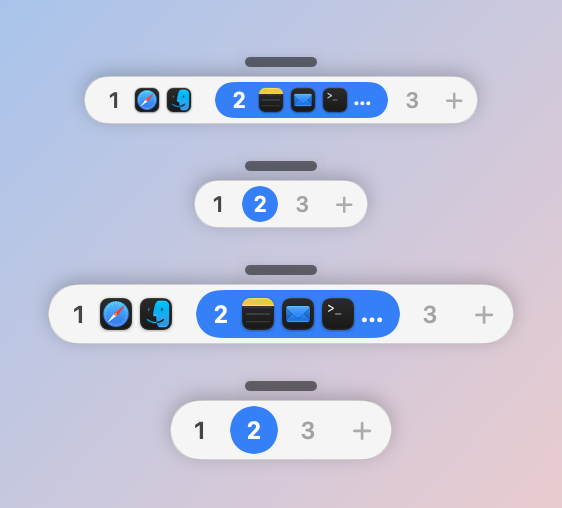
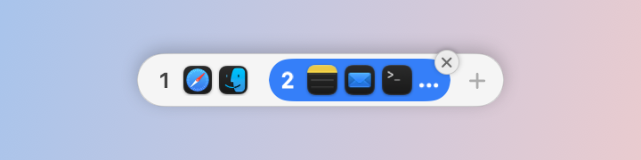
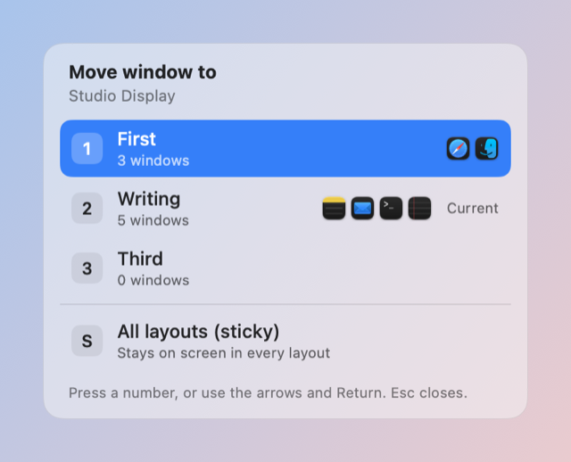
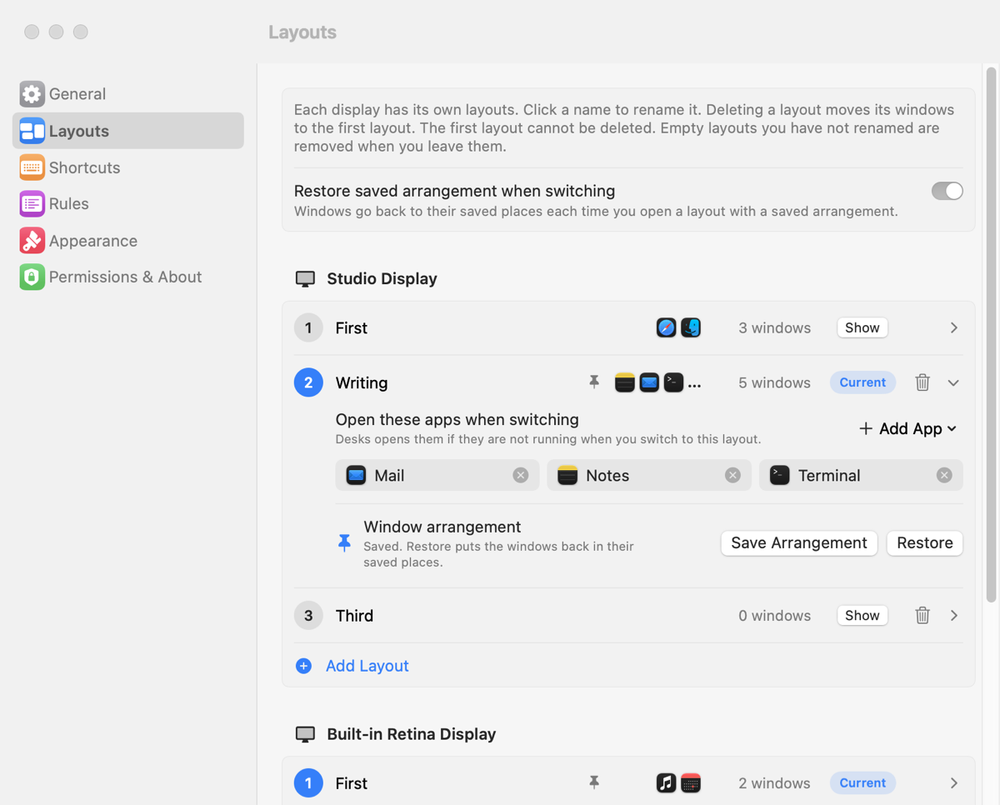
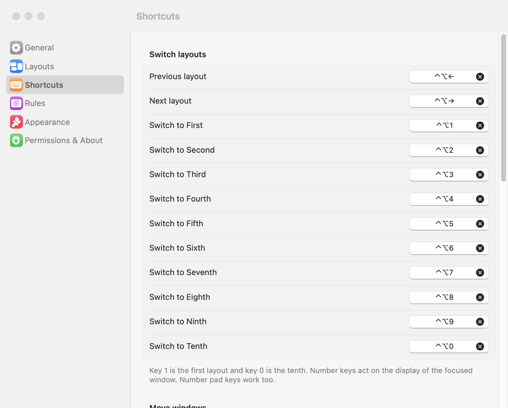
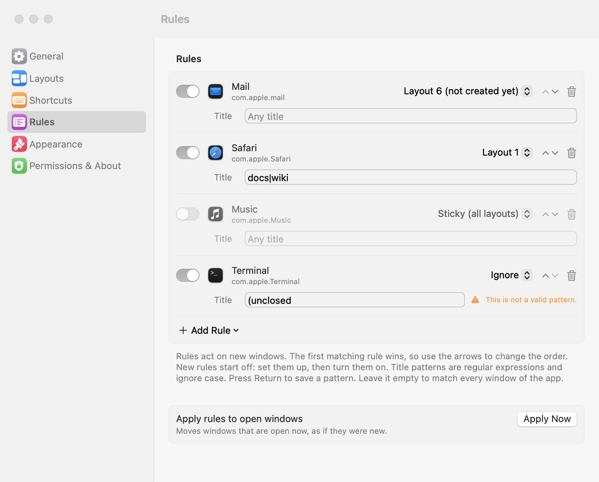
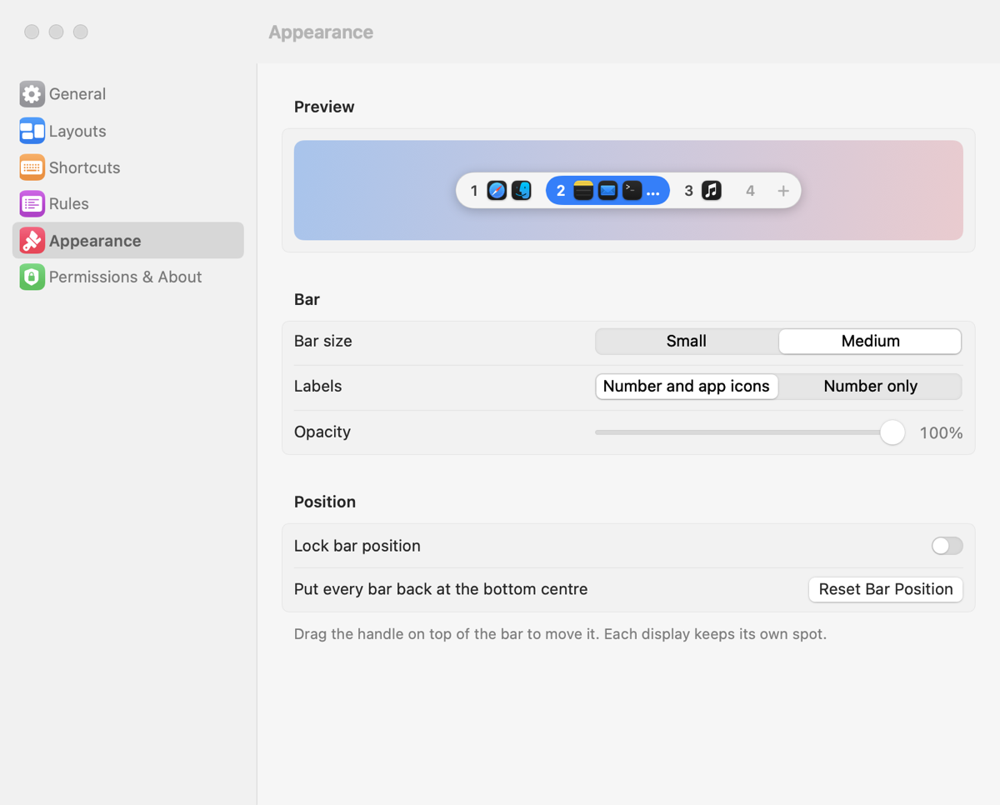
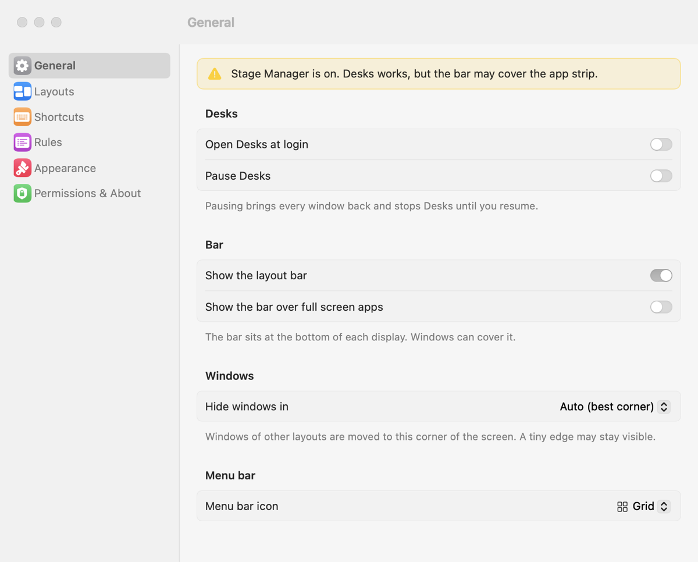

# Desks

Free layouts for every display on macOS. Switch between named groups of windows with one key press, without Spaces and without turning SIP off.

[](https://github.com/shanto462/desks/actions/workflows/ci.yml)
[](https://github.com/shanto462/desks/releases/latest)
[](LICENSE)


<p align="center">
  <picture>
    <source media="(prefers-color-scheme: dark)" srcset="docs/images/bar-dark.png">
    
  </picture>
</p>

Desks is a menu bar app. A layout is a named group of windows. Each display has its own layouts. When you switch layouts, Desks moves the windows of the other layouts to a screen corner and brings the target ones back. A small bar at the bottom of the screen shows your layouts, and keyboard shortcuts do the rest.

## Why Desks

- **Per display.** Each display has its own named layouts and its own shortcuts. Switching on one display does not touch the others. This works on top of your normal macOS setup, with or without "Displays have separate Spaces".
- **Instant.** There is no sliding animation, so a switch is fast. Windows are moved with the Accessibility API, not hidden or minimised.
- **One app, many layouts.** Layouts hold single windows, not whole apps. Two windows of one app can live in two layouts.
- **No special setup.** No SIP changes, no Screen Recording permission, no kernel extension. One permission: Accessibility.
- **Keyboard first, and scriptable.** Every action has a shortcut, a `desks://` URL and a command line tool.
- **Works with what you have.** It does not replace the Dock, Mission Control or Stage Manager. See [Troubleshooting](#troubleshooting) for the few places where they overlap.
- **Free and open source** (MIT). No network access, no telemetry.

## Features

- Layouts per display, up to 10. The first layout always exists.
- Instant switch by parking: windows of other layouts wait in a screen corner.
- New windows join the current layout.
- Sticky windows: shown in every layout of their display.
- Move overlay: send the focused window to a layout, or make it sticky.
- Pill bar at the bottom of each display with layout numbers and app icons. Draggable, with its own place per display.
- Rules per app: send windows to a layout, make them sticky, or ignore them.
- Apps to open with a layout.
- Saved arrangements: save and restore the window places of a layout.
- Cmd-Tab into a parked window switches to that window's layout.
- Layouts and window membership survive relaunch and reboot. A crash journal brings parked windows back after a crash.
- Handles full screen apps, dialogs, sleep and wake, and plugging displays in and out.
- Rebindable shortcuts, launch at login, light and dark mode, Reduce Motion.
- `desks://` URL scheme and a `desks` command line tool.

The exact rules for every feature are in [docs/BEHAVIOR.md](docs/BEHAVIOR.md).

## Install

### Download (recommended)

1. Download `Desks-<version>.zip` from the [latest release](https://github.com/shanto462/desks/releases/latest).
2. Unzip it and move `Desks.app` to `/Applications`.
3. The app is **not notarized** (it is free software without an Apple developer account). The first time, right-click `Desks.app`, choose **Open**, then **Open** again in the dialog. If macOS still blocks it, open System Settings > Privacy & Security and click **Open Anyway**.
4. Grant Accessibility access when asked (see [Permissions and privacy](#permissions-and-privacy)).

Optional: check the download with the `.sha256` file from the release: `shasum -a 256 -c Desks-<version>.zip.sha256`.

Release builds are signed ad-hoc, so macOS may ask for the Accessibility permission again after you install an update. If Desks is in the list but does not work, remove it with the minus button, add it again, then quit and reopen Desks.

### Build from source

You need macOS 13 or newer and Xcode or the Xcode command line tools (Swift 5.9 or newer).

```sh
git clone https://github.com/shanto462/desks.git
cd desks
scripts/make-signing-identity.sh   # once per Mac, optional but recommended
scripts/build-app.sh               # builds build/Desks.app
open build/Desks.app
```

See [Building](#building) for what the scripts do.

## Usage

### The bar

<p align="center">
  <picture>
    <source media="(prefers-color-scheme: dark)" srcset="docs/images/bar-hover-delete-dark.png">
    
  </picture>
</p>

- Click a number to switch to that layout. Click "+" to make a new, empty layout.
- Hover a layout to show its delete button. Deleting moves its windows to the first layout. The first layout cannot be deleted.
- Right-click a layout for rename, move all windows, and the arrangement actions.
- Drag the small handle above the bar to move it. Each display keeps its own place. You can lock the position or reset it in Settings > Appearance.

### Shortcuts

All shortcuts can be changed in Settings > Shortcuts. The number pad digits work too.

| Keys | Action |
|---|---|
| ⌃⌥1 to ⌃⌥9, ⌃⌥0 | Switch to layout 1 to 9, and ⌃⌥0 is layout 10. Acts on the display of the focused window. |
| ⌃⌥← / ⌃⌥→ | Previous / next layout |
| ⌃⌥⇧1 to ⌃⌥⇧9, ⌃⌥⇧0 | Move the focused window to layout 1 to 10 |
| ⌃⌥M | Open the move overlay |
| ⌃⌥S | Toggle sticky on the focused window |
| ⌃⌥N | New layout (opens empty) |
| ⌃⌥B | Show or hide the bar |
| ⌃⌥⇧R | Rescue: bring all windows back (acts at once, no question) |
| ⌃⌥, | Open Settings |
| (none) | Save arrangement, Restore arrangement |

Pressing the switch shortcut for a layout that does not exist does nothing. Use "+" or ⌃⌥N to make one. Moving a window to a layout that does not exist (shortcut, URL or CLI) makes a new layout at the end of the list.

### Move overlay and sticky windows

<p align="center">
  <picture>
    <source media="(prefers-color-scheme: dark)" srcset="docs/images/move-overlay-dark.png">
    
  </picture>
</p>

Press ⌃⌥M, then a number, or use the arrows and Return. Esc closes the overlay. The last row, "All layouts (sticky)", makes the window sticky: it is never parked and shows in every layout of its display. ⌃⌥S toggles sticky directly.

### Rules

Rules (Settings > Rules) decide what happens to a window when it opens. Every rule needs an app (its bundle id). You can add a title pattern (a regular expression, case does not matter) to narrow the rule to some windows of that app. The action is one of: send the window to a layout, make it sticky, or ignore it (Desks never moves it). The first matching rule wins, so you can change the order with the arrows. New rules start disabled. Turn a rule on when it is ready. The title pattern is saved when you press Return or leave the field.

### Apps to open with a layout

In Settings > Layouts you can list apps for a layout. Every time you switch to that layout with a shortcut, the bar, or next/previous, Desks opens each listed app that is not running, in the background. Cmd-Tab does not do this. Only the first new window of that app, within 15 seconds, joins the layout.

### Saved arrangements

Save arrangement stores the position and size of the windows in the current layout. Restore arrangement puts them back. Find them in the right-click menu of the bar and in Settings > Layouts, or use the URL scheme or the CLI. There are no default keys, but you can set your own. Settings > Layouts also has an option to restore the arrangement each time you switch.

### Automation (URL scheme and CLI)

Desks registers the `desks://` URL scheme. Numbers start at 1, so `1` is the first layout and `10` is the tenth.

| URL | Action |
|---|---|
| `desks://switch/N` | Switch to layout N (1 to 10) |
| `desks://next` | Next layout |
| `desks://previous` | Previous layout |
| `desks://new` | New layout (opens empty) |
| `desks://move/N` | Move the focused window to layout N (1 to 10) |
| `desks://sticky` | Toggle sticky on the focused window |
| `desks://overlay` | Open the move overlay |
| `desks://rescue` | Rescue: bring all windows back (Desks asks for confirmation) |
| `desks://pause` | Pause Desks (everything is shown) |
| `desks://resume` | Resume Desks |
| `desks://settings` or `desks://settings/<page>` | Open Settings, optionally on one page (`general`, `layouts`, `shortcuts`, `rules`, `appearance`, `about`) |
| `desks://save-arrangement` | Save arrangement |
| `desks://restore-arrangement` | Restore arrangement |

`switch`, `next`, `previous`, `new`, `save-arrangement` and `restore-arrangement` can end with `?display=<display id>` (a display UUID, or `display-<number>` for a display without a UUID) to act on one display. Without it, Desks uses the display of the focused window. The other URLs do not accept `?display=`.

The `desks` command runs these URLs in the background (`open -g`, so it does not take focus). It checks its input and exits with code 2 and a usage line if something is wrong.

```sh
scripts/install-cli.sh                 # links it to ~/.local/bin/desks, no sudo
desks switch 2                         # go to the second layout
desks move 3                           # move the focused window to the third layout
desks next
desks settings rules
desks switch 1 --display 37A1F2B0-0000-0000-0000-000000000000
desks help
```

Set `DESKS_DRY_RUN=1` to print the URL instead of opening it. The same URLs work in Shortcuts, Raycast, Alfred, `open "desks://next"` and shell scripts.

## Settings

Open Settings from the menu bar menu or with ⌃⌥,.

<p align="center">
  <picture>
    <source media="(prefers-color-scheme: dark)" srcset="docs/images/settings-layouts-dark.png">
    
  </picture>
</p>

- **General:** open at login, pause, show the bar, show the bar over full screen apps, the corner where windows are parked, the menu bar icon.
- **Layouts:** layouts per display, rename, delete, apps to open, save and restore arrangements.
- **Shortcuts:** one recorder per action, with conflict warnings.
- **Rules:** per app rules.
- **Appearance:** bar size, labels (numbers and app icons, or numbers only), opacity, lock and reset the bar position.
- **Permissions & About:** Accessibility status, the Bring all windows back button, credits.

<details>
<summary>More screenshots</summary>

<p align="center">
  <picture>
    <source media="(prefers-color-scheme: dark)" srcset="docs/images/settings-shortcuts-dark.png">
    
  </picture>
  <picture>
    <source media="(prefers-color-scheme: dark)" srcset="docs/images/settings-rules-dark.png">
    
  </picture>
  <picture>
    <source media="(prefers-color-scheme: dark)" srcset="docs/images/settings-appearance-dark.png">
    
  </picture>
  <picture>
    <source media="(prefers-color-scheme: dark)" srcset="docs/images/settings-general-dark.png">
    
  </picture>
</p>

</details>

## Permissions and privacy

Desks needs one permission: **Accessibility**. It is used to read window positions and to move and focus windows. To grant it:

1. Open Desks. macOS asks for access, or open System Settings > Privacy & Security > Accessibility.
2. Turn Desks on.

Desks does not need Screen Recording, Input Monitoring, Full Disk Access or any other permission. It is not sandboxed, because the sandbox does not allow controlling other apps.

**Private API calls.** To work well, Desks uses a few macOS functions that are not documented. None of them needs an extra permission:

- `_AXUIElementGetWindow` gives a stable id for a window.
- `_SLPSSetFrontProcessWithOptions` (SkyLight) is a fallback to bring a window to the front when the normal Accessibility way does not work.
- CGWindowList (this one is public) reads window information.

Desks does not use private Spaces APIs, does not inject code into other apps, and works with SIP on.

**Network and data.** Desks has no network code and no telemetry. Its data stays on your Mac: layouts and window membership in `~/Library/Application Support/Desks`, preferences in the standard macOS preferences.

## Troubleshooting

- **Windows are stuck in a corner.** Press ⌃⌥⇧R, or choose "Bring all windows back" in the menu bar menu or in Settings > Permissions & About (the Settings button and `desks://rescue` ask first). This moves every window into the current layout, so your layouts lose their windows. To only see everything for a while, use **Pause Desks** in the menu bar menu: it shows all windows and keeps your layouts. After a crash, Desks also restores parked windows when it starts again.
- **Shortcuts do nothing.** Check that Accessibility is on for Desks. Check Settings > Shortcuts for a conflict warning. Another app may use the same keys.
- **Accessibility is on but Desks does not work.** Remove Desks from the Accessibility list with the minus button, add it again, then quit and reopen Desks. This is needed after an update of an ad-hoc signed build.
- **Mission Control shows parked windows.** Parked windows appear very small in a corner of Mission Control. In System Settings > Desktop & Dock, turn on "Group windows by application" to keep it tidy. Desks does not change this setting.
- **Stage Manager.** Desks shows a warning when Stage Manager is on. It keeps working, but Stage Manager is not tested and can interfere with window parking and with the bar. Turn it off for the best result.
- **A thin edge of a parked window is visible.** macOS keeps about one pixel of a window on screen. This is a system limit.
- **An app does not behave (for example Zoom).** Some apps refuse to be moved or jump back. Add a rule with the action "Ignore" for that app.
- **A window opened in the wrong layout.** New windows join the current layout. Use a rule to send an app to a fixed layout.

Still stuck? [Open an issue](https://github.com/shanto462/desks/issues/new/choose). Do not include private window titles.

## Uninstall

### Uninstall the app

1. Quit Desks from the menu bar (it restores all windows on quit).
2. Delete `Desks.app`.
3. Delete the app data: `rm -f ~/Library/Application\ Support/Desks/state.json ~/Library/Application\ Support/Desks/journal.json`
4. Optional: delete the preferences with `defaults delete io.github.desks.app`.
5. In System Settings > Privacy & Security > Accessibility, select Desks and click the minus button.

Keep the `signing` folder inside `~/Library/Application Support/Desks` if you plan to build Desks again. It holds the keychain password.

### Remove the build identity too

Only if you built Desks yourself. Delete the keychain and the signing folder together. If you delete only one of them, the build scripts stop working (see Building).

```sh
security delete-keychain ~/Library/Keychains/desks-dev.keychain-db
rm -rf ~/Library/Application\ Support/Desks
```

## Building

```sh
scripts/make-signing-identity.sh   # once per Mac
scripts/build-app.sh               # builds build/Desks.app
```

- `make-signing-identity.sh` creates a self-signed "Desks Dev" certificate in its own keychain (`~/Library/Keychains/desks-dev.keychain-db`). It never touches your login keychain. The keychain password is a random file in `~/Library/Application Support/Desks/signing/` that only you can read. The build unlocks the keychain only while it signs, then locks it again. No password dialog should appear. Every build is signed with the same certificate, so macOS keeps the Accessibility permission when you rebuild.
- `build-app.sh` builds in release mode, assembles `build/Desks.app`, signs it with the hardened runtime and checks the signature. If the "Desks Dev" identity is missing, it signs ad-hoc and prints a warning. In CI (`CI=true`) it always signs ad-hoc and never touches a keychain.
- If the keychain exists but its password file is missing (for example you deleted `~/Library/Application Support/Desks`), the build warns loudly and signs ad-hoc. Run `scripts/make-signing-identity.sh --reset` to delete both and create them again. You will need to grant Accessibility once more, because the certificate is new.
- `scripts/screenshots.sh` regenerates the images in `docs/images` with the offscreen render mode.

## Contributing

Issues and pull requests are welcome. Read [CONTRIBUTING.md](CONTRIBUTING.md) first. For security problems see [SECURITY.md](SECURITY.md). Changes are listed in [CHANGELOG.md](CHANGELOG.md).

## License

[MIT](LICENSE), Copyright (c) 2026 Desks contributors.

## Credits

- [KeyboardShortcuts](https://github.com/sindresorhus/KeyboardShortcuts) by Sindre Sorhus (MIT) records and handles the global shortcuts.
- [AeroSpace](https://github.com/nikitabobko/AeroSpace) (MIT) is a reference for working with the macOS Accessibility API. Some parts are adapted from it.

See [THIRD_PARTY_NOTICES.md](THIRD_PARTY_NOTICES.md) for the license texts.
